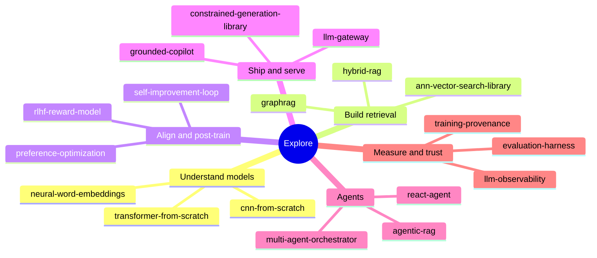
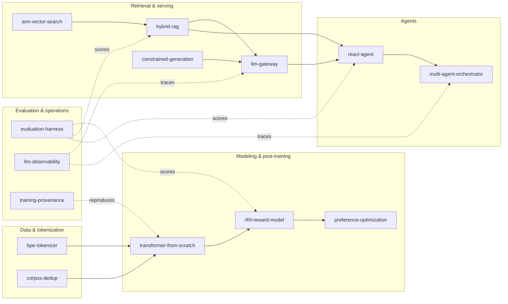

<h1 align="center">Adeolu Ogunnoiki</h1>

  <samp>AI&nbsp;Engineer&nbsp;·&nbsp;Machine&nbsp;Learning&nbsp;·&nbsp;From&nbsp;first&nbsp;principles</samp>

  I build AI and ML systems <b>from scratch in pure Python</b> &mdash; transformers and autodiff,
  retrieval and vector search, alignment and RLHF, agents, evaluation, and the infrastructure
  around them. Every project is implemented with <b>zero third-party runtime dependencies</b>,
  is deterministic and offline, ships with green CI and real benchmarks, and is validated
  against established libraries where it matters.

---

### Start here

### How the flagships fit together

---

### Flagship projects

Each pairs a from-scratch implementation with independent validation and honest, reproducible evidence.

| Project | What it is | Evidence of depth |
|---|---|---|
| [transformer-from-scratch](https://github.com/adeoluo/transformer-from-scratch) | A decoder-only transformer and a reverse-mode autodiff engine in pure Python | Gradients checked against **PyTorch to < 1e-9**; trains real text to **3.64 bits/char** vs a 4.30 baseline; checkpointing |
| [evaluation-harness](https://github.com/adeoluo/evaluation-harness) | A model/agent evaluation framework: tasks, graders, statistics | Statistics cross-validated against **scipy** to machine precision; bootstrap CIs, McNemar, Cohen's d |
| [ann-vector-search-library](https://github.com/adeoluo/ann-vector-search-library) | HNSW approximate nearest-neighbor search from scratch | **Matches hnswlib's recall** at matched parameters; honest latency comparison vs hnswlib and FAISS |
| [rlhf-reward-model](https://github.com/adeoluo/rlhf-reward-model) | Reward modeling with PPO and DPO | PPO-vs-DPO comparison and a **reward over-optimization (Goodhart) study** |
| [constrained-generation-library](https://github.com/adeoluo/constrained-generation-library) | Schema-constrained decoding via compiled automata | **240/240** outputs validate against the `jsonschema` reference; agrees with it on 2,008 cases |
| [llm-gateway](https://github.com/adeoluo/llm-gateway) | An LLM gateway: safety, caching, reliability | Retry/failover, per-tenant isolation, injection and PII detection, concurrency-tested |
| [hybrid-rag](https://github.com/adeoluo/hybrid-rag) | Hybrid retrieval: BM25, TF-IDF, fusion, reranking | A full retrieval evaluation suite (recall@k, MRR, nDCG, MAP) with ablations |
| [react-agent](https://github.com/adeoluo/react-agent) | A ReAct reasoning-and-acting agent | Adversarial tool-use robustness, recovery, and an agent benchmark |
| [training-provenance](https://github.com/adeoluo/training-provenance) | Content-addressed ML reproducibility and lineage | End-to-end reproduce, crash recovery, and an exhaustive tamper-detection matrix |
| [multi-agent-orchestrator](https://github.com/adeoluo/multi-agent-orchestrator) | Planner / worker / critic orchestration over a blackboard | Durable execution with resume, and an honest single-agent-vs-orchestrator comparison |

### More projects, by theme

- **From-scratch deep learning** &mdash; [cnn-from-scratch](https://github.com/adeoluo/cnn-from-scratch), [neural-word-embeddings](https://github.com/adeoluo/neural-word-embeddings)
- **Open-source libraries** &mdash; [bpe-tokenizer-library](https://github.com/adeoluo/bpe-tokenizer-library), [corpus-dedup-library](https://github.com/adeoluo/corpus-dedup-library)
- **Retrieval & RAG** &mdash; [graphrag](https://github.com/adeoluo/graphrag), [agentic-rag](https://github.com/adeoluo/agentic-rag)
- **Alignment & post-training** &mdash; [preference-optimization](https://github.com/adeoluo/preference-optimization), [self-improvement-loop](https://github.com/adeoluo/self-improvement-loop)
- **Evaluation & safety** &mdash; [factuality-auditor](https://github.com/adeoluo/factuality-auditor), [red-teaming](https://github.com/adeoluo/red-teaming), [llm-observability](https://github.com/adeoluo/llm-observability)
- **Experiments & tuning** &mdash; [hyperparameter-optimizer](https://github.com/adeoluo/hyperparameter-optimizer), [sweep-orchestrator](https://github.com/adeoluo/sweep-orchestrator), [prompt-optimizer](https://github.com/adeoluo/prompt-optimizer)
- **LLM-powered products** &mdash; [ai-code-reviewer](https://github.com/adeoluo/ai-code-reviewer), [grounded-copilot](https://github.com/adeoluo/grounded-copilot), [nl-sql-analyst](https://github.com/adeoluo/nl-sql-analyst)
- **Classical ML & NLP** &mdash; [crf-sequence-labeler](https://github.com/adeoluo/crf-sequence-labeler), [dependency-parser](https://github.com/adeoluo/dependency-parser), [statistical-translation](https://github.com/adeoluo/statistical-translation), [topic-model-lda](https://github.com/adeoluo/topic-model-lda)

---

### What every repository shares

<samp>
pure Python, zero third-party runtime dependencies &nbsp;·&nbsp; deterministic & offline &nbsp;·&nbsp; green CI (ruff, mypy&nbsp;--strict, pytest) &nbsp;·&nbsp; typed, documented, benchmarked &nbsp;·&nbsp; architecture notes & ADRs &nbsp;·&nbsp; independent validation against established libraries where it counts
</samp>

  
  

  

  

