# Adeolu Ogunnoiki

**AI Systems, Security & ML Engineer Who Directs Multi-Agent Workflows**

Bachelor of Computer Science with Distinction (Certificate of Specialization in Data Science) @ **Dalhousie University** 
Pursuing Master of Data Science (Focus: Artificial Intelligence & Machine Learning) @ **Johns Hopkins University**

`Python` · `Rust` · `Go` · `TypeScript`

---

I build machine learning infrastructure, static and runtime AI security scanners, search ranking engines, and fault-tolerant multi-tenant agent services across **Python, Rust, Go, and TypeScript** (with targeted C/NEON kernels in [`ml-graph-compiler`](https://github.com/adeoluo/ml-graph-compiler) and [`vectordb-go`](https://github.com/adeoluo/vectordb-go)). Every algorithmic or statistical claim is checked head-to-head against established reference systems (**PyTorch, ONNX Runtime, SciPy, FAISS, hnswlib, LightGBM, XGBoost, scikit-learn, tiktoken, Semgrep, picklescan, fickling, and garak**) with raw JSON benchmark artifacts and reproduction scripts committed in-tree.

---

## Flagship Systems, Live CI & Unedited Empirical Tradeoffs

Every row pairs live CI and raw evaluation reports with both where the implementation wins and where reference baselines, wild corpora, or distribution shifts expose its limits. *(Benchmarks ran on one 8-core Apple M1: 4 performance + 4 efficiency cores, 8 GB RAM.)*

| System & Live CI | Stack | What It Is | Verified Results & Unflattering Boundaries |
| --- | --- | --- | --- |
| **[ml-graph-compiler](https://github.com/adeoluo/ml-graph-compiler)**  [eval report](https://github.com/adeoluo/ml-graph-compiler/blob/main/docs/EVALUATION_REPORT.md) | `Python` · `C` | ONNX-to-SSA graph compiler: fusion & NHWC layout passes, static arena planner (`113.6 -> 3.0 MB` on GPT-2), clang NEON + OpenMP C codegen (892 LOC C), `mlir-opt`-verified MLIR export | **100% Top-1 parity** with `onnxruntime` (3,925 Imagenette images; 6,400 BERT/GPT-2 token positions). At **8 threads** across the 4P+4E M1 cores (load avg `3.0-8.2`), OpenMP dynamic tile scheduling beats `onnxruntime` CPU by **1.23x - 1.37x** on ResNet-50 (`29.8 vs 40.9 ms`), BERT-base (`72.0 vs 88.8 ms`), and GPT-2 (`109.7 vs 149.4 ms`), and ties MobileNetV2 (`6.0 ms`). *Where it loses:* at **1 thread** (`1.12x - 1.16x`) and **4 P-core threads** (`1.05x - 1.38x`), `onnxruntime` MLAS wins on all 4 models, and PyTorch Apple Accelerate AMX leads on transformers (`1.20x - 1.32x` at 8t; `4.27x - 5.56x` at 1t). |
| **[vectordb-go](https://github.com/adeoluo/vectordb-go)**  [raw results](https://github.com/adeoluo/vectordb-go/tree/main/benchmarks/results) | `Go` | Standalone concurrent, persistent HNSW vector database server with group-commit checksummed WAL, directory fsyncs, torn-tail truncation, and HTTP API | Race-clean and crash-tested WAL recovery across torn tails and concurrent writers; on **1,000,000 SIFT vectors**, custom ARM64 NEON assembly distance kernels (76 LOC asm) answer **1.3x - 3.5x faster than `hnswlib`** at matched recall. *Boundary:* speedup holds on ARM64 only, where `hnswlib` has no hand-written NEON SIMD and compiles to scalar C++. |
| **[model-supply-chain-scanner](https://github.com/adeoluo/model-supply-chain-scanner)**  [eval report](https://github.com/adeoluo/model-supply-chain-scanner/blob/main/docs/EVALUATION_REPORT.md) | `Rust` · `Python` | Pre-deserialization static scanner across `pickle`, PyTorch, `joblib`, NumPy, Keras, SavedModel, ONNX, GGUF, and `safetensors` + SARIF | Scanned **7,607 wild Hugging Face Hub files across 2,888 repos** in `9.8s` (`31/7,563` non-attack high alerts; Hub content labels share the scanner's structural parsers, so `17/17` payload agreement and `0` benign flags are consistency checks rather than independent ground-truth recall). On the authored 194-file multi-format suite, `114/116` (`98.3%`) vs `picklescan` (`59.5%`) and `fickling` (`62.9%`, `39.7%` FPR) reflects broader format coverage; on standard malicious pickles the tools are close (**`63/63` vs `59/63` and `62/63`**), and unknown callables inside trusted library namespaces remain `low`/`medium` unless explicitly denylisted. |
| **[mcp-security-scanner](https://github.com/adeoluo/mcp-security-scanner)**  [eval report](https://github.com/adeoluo/mcp-security-scanner/blob/main/docs/EVALUATION_REPORT.md) | `Go` | Static taint analyzer and live protocol prober for Model Context Protocol servers (tool poisoning, injection, traversal, rug-pulls) + SARIF | On 432 authored planted + safe look-alike servers, reaches **0.968 recall at 8.5% FPR** (`1.00 / 0.02` on standard taint tiers vs Semgrep OSS `0.59` injection / `0.00` traversal, but **`0/4` hard command injections** and `0/60` paraphrased poisoning). Across **1,013 wild public MCP repos** (12.2M LOC), rubric-audited precision (agent-inspected against a written rubric) is **`0.80 - 1.00`** on CORS/TLS/bind/OAuth, **`0.92` correct / `0.08` actionable** on path traversal, **`11/22`** on secrets, and **weak on noisy rules: `2/7` (`0.29`) command injection, `2/11` (`0.18`) SSRF, and `0/34` (`0.00`) source-text tool poisoning**. |
| **[lambdamart-ranking-engine](https://github.com/adeoluo/lambdamart-ranking-engine)**  [eval report](https://github.com/adeoluo/lambdamart-ranking-engine/blob/main/docs/EVALUATION_REPORT.md) | `Rust` · `Python` | LambdaMART search ranking engine with a Rust histogram tree core, neural rankers, click models, and counterfactual IPW | **0.5029 NDCG@10** over 5 folds of **MSLR-WEB10K** (1.2M docs, 10k queries) - `0.0013` below **LightGBM `0.5042`** (not significant, paired `p = 0.103`) vs **XGBoost `0.5061`**; on **Istella-S** (3.4M pairs), scores **0.7603 NDCG@10** vs LightGBM `0.7595` and XGBoost `0.7554`. *Training speed (500 trees, MSLR):* **LightGBM is fastest at `39.7s`**, ahead of this package (`68.1s`) and XGBoost (`81.5s`). |
| **[prompt-injection-detector](https://github.com/adeoluo/prompt-injection-detector)**  [eval report](https://github.com/adeoluo/prompt-injection-detector/blob/main/docs/EVALUATION_REPORT.md) | `Rust` · `Python` | Hybrid prompt-injection classifier: **27 us** Rust hashed n-gram FTRL core (`17x` faster than `scikit-learn` at `464 us`) + fine-tuned `e5-small` | MinHash-deduplicated split across 13 public datasets (91,089 test prompts): **0.9996 in-distribution AUROC** (`99.5%` TPR at `1%` FPR), matching `scikit-learn` hashing+SGD on the same data (**`0.9995` AUROC**, `99.4%` TPR) while scoring in **`27 us vs 464 us`** (published ProtectAI DeBERTa reaches **`87.6%` TPR at `1%` FPR** without retraining on all 13 sources). *Limits:* high ID AUROC reflects source-style learning - on unseen held-out families TPR drops to **`45.3%` (Lakera), `42.1%` (SPML), and `22.6%` (deepset)**, and leetspeak (`0.6%`) defeats n-grams. |
| **[corpus-dedup-library](https://github.com/adeoluo/corpus-dedup-library)** · **[bpe-tokenizer-library](https://github.com/adeoluo/bpe-tokenizer-library)**  [dedup report](https://github.com/adeoluo/corpus-dedup-library/blob/main/docs/EVALUATION_REPORT.md) · [BPE report](https://github.com/adeoluo/bpe-tokenizer-library/blob/main/docs/EVALUATION_REPORT.md) | `Rust (PyO3)` · `Python` | Bit-exact MinHash/LSH deduplicator and lossless GPT-2 byte-level BPE tokenizer matching Python references token-for-token | `corpus-dedup-library` streams **1.4M C4 docs in 30s** (and runs **13.7x faster** than Python `datasketch` on a 50k-doc head-to-head slice); `bpe-tokenizer-library` trains a 50,257-token vocab on 100 MB C4 in **6.7s** and Rayon batch-encodes at **68.5 vs 52.4 MB/s** vs `tiktoken` (*Boundary:* single-string latency favors `tiktoken`). |
| **[agent-platform](https://github.com/adeoluo/agent-platform)**  [benchmarks](https://github.com/adeoluo/agent-platform/tree/main/benchmarks) | `Python` · `TypeScript` | Multi-tenant service composing safety gateway, OpenAI/Anthropic failover, hybrid RAG, stdio MCP server, memory, and fenced SQLite job leases | HMAC-peppered API keys, strict tenant isolation, and **0 checkpointed steps re-run** under `SIGKILL` worker crashes (at-least-once execution on the interrupted step). *Boundary:* the **516 req/s** cached / **244 req/s** uncached loopback figures (`p99` `48 ms` / `142 ms` across 20 tenants) run against the deterministic offline policy model and hashed-feature vectors (`uv sync` installs all dependencies automatically) to measure SQLite lease and gateway overhead, not live LLM quality. |

---

## Complete Open-Source Stack & Architectural Boundaries (20 Repositories)

  

<table>
<tr>
<td width="50%" valign="top">

### 1. Data, Pedagogical Internals & Post-Training
- **[corpus-dedup-library](https://github.com/adeoluo/corpus-dedup-library)** (`Rust` · `Python`) - MinHash/LSH near-deduplication and quality filtering at C4 scale.
- **[bpe-tokenizer-library](https://github.com/adeoluo/bpe-tokenizer-library)** (`Rust` · `Python`) - Lossless GPT-2 byte-level BPE with PyO3 bindings and parallel batch encoding.
- **[prompt-optimizer](https://github.com/adeoluo/prompt-optimizer)** (`Python`) - Seven optimizers (MIPROv2, TextGrad, GEPA, OPRO, APE, PromptBreeder, bootstrap) benchmarked on real local `Qwen3.5` models across GSM8K & BBH vs DSPy 3.4.1.
- **[transformer-from-scratch](https://github.com/adeoluo/transformer-from-scratch)** (`Python`) - *Pedagogical white-box library:* minimal 2-D NumPy reverse-mode autodiff + tiny decoder transformer (copy task + 1,718-char prose slice), with forward logits and all 48 backward gradients verified `< 1e-9` vs PyTorch in CI + 8-seed induction ablation (null result).
- **[rlhf-reward-model](https://github.com/adeoluo/rlhf-reward-model)** (`Python`) - *Controlled synthetic study:* Bradley-Terry reward modeling, PPO vs DPO alignment, and Goodhart over-optimization on a 12-feature synthetic bandit (NumPy gradient parity in CI; no LLM weights).

</td>
<td width="50%" valign="top">

### 2. Compilers, Search & Applied ML
- **[ml-graph-compiler](https://github.com/adeoluo/ml-graph-compiler)** (`Python` · `C`) - ONNX-to-SSA compiler with fusion passes, static arena planning, clang NEON/OpenMP C codegen, and `mlir-opt`-verified MLIR export.
- **[vectordb-go](https://github.com/adeoluo/vectordb-go)** (`Go`) - *Standalone networked server:* concurrent HNSW database with group-commit WAL, fsync crash recovery, and HTTP API.
- **[ann-vector-search-library](https://github.com/adeoluo/ann-vector-search-library)** (`Rust SIMD` · `Python`) - *In-process embeddable library:* PyO3 HNSW index linked directly inside Python retrieval pipelines (`hybrid-rag`, `agent-platform`).
- **[hybrid-rag](https://github.com/adeoluo/hybrid-rag)** (`Python`) - Inverted-index BM25, TF-IDF, RRF, and reranking (`0.687 nDCG@10` for stemmed BM25 vs `0.665` hybrid fusion on BEIR SciFact; `0.666` hybrid vs `0.663` BM25 on 171k-doc TREC-COVID).
- **[lambdamart-ranking-engine](https://github.com/adeoluo/lambdamart-ranking-engine)** (`Rust` · `Python`) - Histogram LambdaMART, neural rankers, and counterfactual IPW ranking on MSLR-WEB10K (1.2M docs) & Istella-S (3.4M pairs).
- **[ad-auction-lab](https://github.com/adeoluo/ad-auction-lab)** (`Rust` · `Python`) - GSP/VCG/first-price auctions, bid shading, budget pacing, hashed Criteo CTR, and Open Bandit off-policy evaluation.

</td>
</tr>
<tr>
<td width="50%" valign="top">

### 3. AI Security & Sandboxing
- **[model-supply-chain-scanner](https://github.com/adeoluo/model-supply-chain-scanner)** (`Rust` · `Python`) - *Static pre-load check:* inspects 8 model serialization formats before weights touch memory; tested on 7,607 Hugging Face Hub files.
- **[mcp-security-scanner](https://github.com/adeoluo/mcp-security-scanner)** (`Go`) - *Protocol & source audit:* taint analysis, rug-pull hash pinning, and live probing evaluated on 432 planted cases + 1,013 public MCP repos (with rubric-audited precision per rule).
- **[prompt-injection-detector](https://github.com/adeoluo/prompt-injection-detector)** (`Rust` · `Python`) - *Input screening:* `27 us` Rust n-gram FTRL scorer + fine-tuned transformer with leave-one-family-out OOD and adversarial rewrite evaluations.
- **[llm-vuln-scanner](https://github.com/adeoluo/llm-vuln-scanner)** (`Python` · `Rust`) - *Live model red-teaming:* 540-probe campaigns across local `Qwen3.5`, `Gemma 4`, and `Granite 4.2` mapped to OWASP LLM/Agentic 2026 & MITRE ATLAS vs `garak`.
- **[agent-sandbox](https://github.com/adeoluo/agent-sandbox)** (`Rust`) - *Runtime containment:* declarative policy engine + OS isolation (`Seatbelt` on macOS, `Landlock` + `cgroup v2 pids.max` / process-group watchdog on Linux) and hash-chained audit logs.

</td>
<td width="50%" valign="top">

### 4. Serving, Multi-Tenant Agents & Telemetry
- **[agent-platform](https://github.com/adeoluo/agent-platform)** (`Python` · `TypeScript`) - *Integrated multi-tenant product:* composes `llm-gateway`, `hybrid-rag`, `ann-vector-search-library`, `evaluation-harness`, and `llm-observability` behind hashed API keys, MCP, and fenced SQLite job leases.
- **[llm-gateway](https://github.com/adeoluo/llm-gateway)** (`Python` · `Go`) - *Standalone ingress layer:* zero-dep Python gateway (with pluggable ML classifier hook) + parity-tested Go reverse proxy for OpenAI/Anthropic failover, PII redaction, and caching.
- **[evaluation-harness](https://github.com/adeoluo/evaluation-harness)** (`Python`) - *Standalone statistical grader:* paired bootstrap CIs, McNemar, Cohen's d (verified to machine precision vs SciPy), and contamination checks.
- **[llm-observability](https://github.com/adeoluo/llm-observability)** (`Python` · `TypeScript`) - *Standalone telemetry stack:* zero-dependency Python span tracer, collector API, cost/SLO engine, and TypeScript trace UI.

</td>
</tr>
</table>
