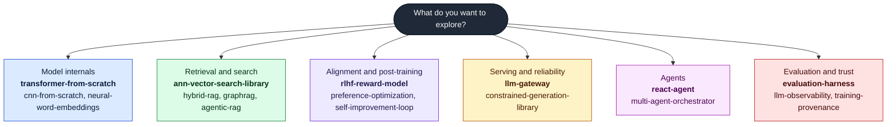
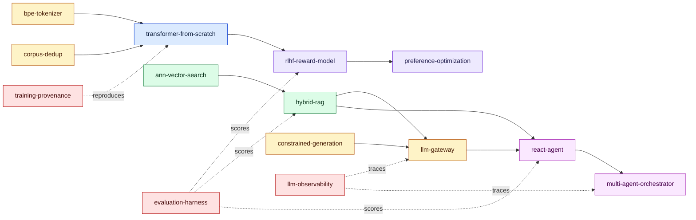

# Adeolu Ogunnoiki

### AI and Machine Learning Engineer

**I build AI systems from scratch, in pure Python, and prove they work.**

Transformers and autodiff, vector search, RLHF and alignment, agents, retrieval, evaluation,
and the infrastructure around them. Every project is implemented with **zero third-party
runtime dependencies**, runs **deterministically and offline**, ships with **green CI** and real
benchmarks, and is **validated against the libraries the industry actually uses**.

 

---

## The portfolio at a glance

Thirty-one focused projects spanning the full AI engineering stack, built from first principles.
The ten flagships below each pair a from-scratch implementation with **independent, reproducible
evidence** that it is correct and effective. The rest cover the breadth: classical ML and NLP,
open-source libraries, retrieval and RAG, agents, evaluation and safety, and language-model
products.

> **What sets this apart:** most portfolios show that something runs. These show, with numbers,
> that the maths is right (gradients checked against PyTorch to 1e-9), that the algorithm is
> competitive (matches hnswlib's recall), and that the honest result is reported even when it is
> not a win (a learned retriever that ties, rather than beats, strong lexical baselines on a small
> corpus).

---

## Find your path

Pick what you want to see. Colors group projects by the stage of the stack they live in, and the
same colors are used everywhere on this page.

**Legend:**
`blue` modeling and training,
`green` retrieval and search,
`purple` alignment and post-training,
`amber` serving and reliability,
`magenta` agents,
`red` evaluation and trust.

---

## How the flagships connect

They are not ten unrelated demos. They compose into one AI engineering pipeline: data is
tokenized and deduplicated, models are trained and aligned, results are retrieved and served,
agents act on them, and everything is evaluated, traced, and reproducible. Colors match the
legend above.

---

## Flagship projects, with the receipts

| Project | What it is | The proof |
|---|---|---|
| [transformer-from-scratch](https://github.com/adeoluo/transformer-from-scratch) | A decoder-only transformer and a reverse-mode autodiff engine | Gradients match **PyTorch to < 1e-9**; learns real text to **3.64 bits/char** vs a 4.30 baseline; checkpointing |
| [evaluation-harness](https://github.com/adeoluo/evaluation-harness) | A model and agent evaluation framework | Statistics cross-checked against **scipy to machine precision**: bootstrap CIs, McNemar, Cohen's d |
| [ann-vector-search-library](https://github.com/adeoluo/ann-vector-search-library) | HNSW approximate nearest-neighbor search | **Matches hnswlib's recall** at matched parameters; honest latency curves vs hnswlib and FAISS |
| [rlhf-reward-model](https://github.com/adeoluo/rlhf-reward-model) | Reward modeling with PPO and DPO | PPO-vs-DPO comparison plus a **reward over-optimization (Goodhart) study** |
| [constrained-generation-library](https://github.com/adeoluo/constrained-generation-library) | Schema-constrained decoding via compiled automata | **240 of 240** outputs validate against the `jsonschema` reference; agree on 2,008 cases |
| [llm-gateway](https://github.com/adeoluo/llm-gateway) | An LLM gateway: safety, caching, reliability | Retry and failover, **per-tenant isolation**, injection and PII detection, concurrency-tested |
| [hybrid-rag](https://github.com/adeoluo/hybrid-rag) | Hybrid retrieval with a from-scratch neural dense retriever | Full evaluation suite; an **honest result**: dense ties recall but ranks below strong lexical at this scale |
| [react-agent](https://github.com/adeoluo/react-agent) | A ReAct reasoning-and-acting agent | **Adversarial** tool-use robustness, recovery, and a benchmark against a single-shot baseline |
| [training-provenance](https://github.com/adeoluo/training-provenance) | Content-addressed ML reproducibility and lineage | End-to-end reproduce, crash recovery, and an exhaustive **tamper-detection matrix** |
| [multi-agent-orchestrator](https://github.com/adeoluo/multi-agent-orchestrator) | Planner, worker, and critic over a shared blackboard | **Durable execution** with resume, and an honest single-agent-vs-orchestrator comparison |

---

## Everything else, by theme

<table>
<tr>
<td valign="top" width="50%">

**From-scratch deep learning**
[cnn-from-scratch](https://github.com/adeoluo/cnn-from-scratch),
[neural-word-embeddings](https://github.com/adeoluo/neural-word-embeddings)

**Open-source libraries**
[bpe-tokenizer-library](https://github.com/adeoluo/bpe-tokenizer-library),
[corpus-dedup-library](https://github.com/adeoluo/corpus-dedup-library)

**Retrieval and RAG**
[graphrag](https://github.com/adeoluo/graphrag),
[agentic-rag](https://github.com/adeoluo/agentic-rag)

**Alignment and post-training**
[preference-optimization](https://github.com/adeoluo/preference-optimization),
[self-improvement-loop](https://github.com/adeoluo/self-improvement-loop)

</td>
<td valign="top" width="50%">

**Evaluation and safety**
[factuality-auditor](https://github.com/adeoluo/factuality-auditor),
[red-teaming](https://github.com/adeoluo/red-teaming),
[llm-observability](https://github.com/adeoluo/llm-observability)

**Experiments and tuning**
[hyperparameter-optimizer](https://github.com/adeoluo/hyperparameter-optimizer),
[sweep-orchestrator](https://github.com/adeoluo/sweep-orchestrator),
[prompt-optimizer](https://github.com/adeoluo/prompt-optimizer)

**Language-model products**
[ai-code-reviewer](https://github.com/adeoluo/ai-code-reviewer),
[grounded-copilot](https://github.com/adeoluo/grounded-copilot),
[nl-sql-analyst](https://github.com/adeoluo/nl-sql-analyst)

**Classical ML and NLP**
[crf-sequence-labeler](https://github.com/adeoluo/crf-sequence-labeler),
[dependency-parser](https://github.com/adeoluo/dependency-parser),
[statistical-translation](https://github.com/adeoluo/statistical-translation),
[topic-model-lda](https://github.com/adeoluo/topic-model-lda)

</td>
</tr>
</table>

---

### How every repository is built

Pure Python, zero runtime dependencies, deterministic and offline, green CI (ruff, mypy strict,
pytest), typed, documented, benchmarked, architecture notes and ADRs, and independent validation
against established libraries where it counts.

Every commit is my own work.

